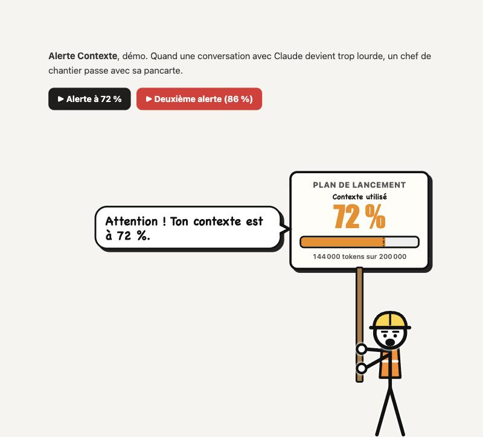
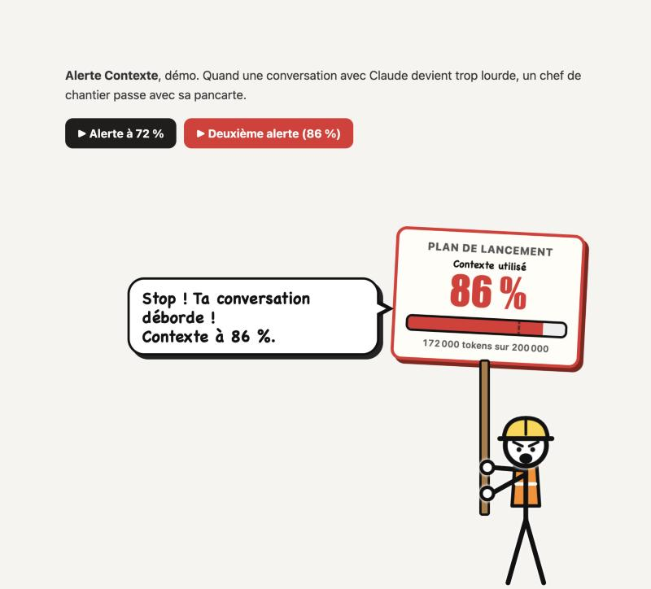

# Alerte Contexte 🪧

Plus une conversation avec Claude s'allonge, plus elle devient lente, moins précise, et plus chaque message consomme ton forfait. Et personne ne regarde la jauge.

**Alerte Contexte** s'en charge : quand une conversation devient trop lourde, un chef de chantier passe en bas de ton écran avec une pancarte. Elle affiche le nom de la conversation, la jauge de contexte et le pourcentage. Il te dit de penser à compacter (`/compact`), puis il repart.

<p align="center">
  
  
</p>

▶ **[Voir la démo dans ton navigateur](https://pablitooo5.github.io/alerte-contexte/demo.html)** (avec le son, sans rien installer)

---

## Installer (Mac)

Ouvre l'app **Terminal** et colle cette ligne :

```bash
curl -fsSL https://raw.githubusercontent.com/Pablitooo5/alerte-contexte/main/install.sh | bash
```

Ensuite, clique sur l'icône **🪧** dans la barre des menus, puis sur **Lancer la démo**.

**Il te faut :**
- un Mac avec macOS 14 (Sonoma) ou plus récent ;
- **Claude Code** : l'onglet *Code* de l'app Claude, ou Claude Code dans le terminal ;
- les outils de développement d'Apple. S'ils manquent, l'installation te le dit ; lance alors `xcode-select --install` puis recommence.

## Quand passe-t-il ?

- **Juste après une réponse de Claude**, jamais pendant qu'il travaille : c'est le bon moment pour compacter.
- **Au-delà de 50 % du contexte** (réglable : 50, 60, 70 ou 80 %). En dessous, tout va bien, il ne dit rien.
- **Une seule fois par seuil et par conversation.** Il repasse une deuxième fois, en rouge et plus énervé, si la conversation continue de grossir.
- Après un `/compact`, le compteur repart de zéro.

L'installation devine la taille de la mémoire de Claude (200 000 ou 1 million de tokens) d'après tes conversations récentes. Tu peux la changer dans le menu.

## Le menu 🪧

- **Lancer la démo**
- **En pause** / **Son**
- **Prévenir à…** : 50, 60, 70 ou 80 %
- **…ou dès 300 000 tokens** : à cocher si tu veux être prévenu plus tôt avec une grande mémoire (1 million de tokens), où Claude ralentit souvent avant 50 %
- **Mémoire de Claude** : 200 000 ou 1 million de tokens

## Comment ça marche

À chaque fin de réponse, un *hook* Claude Code lit le fichier de la conversation (Claude Code y note les tokens utilisés), calcule la taille du contexte et prévient l'app si un seuil vient d'être franchi. L'app fait passer le personnage ; les clics traversent toujours ses dessins.

Rien n'est envoyé sur Internet. Tout tient dans `~/.claude/alerte-contexte` et dans un hook de `~/.claude/settings.json`. Une copie de tes réglages est gardée à côté (`settings.json.avant-alerte-contexte.bak`).

## Désinstaller

```bash
~/.claude/alerte-contexte/uninstall.sh
```

## À savoir

Projet perso et non officiel, sans lien avec Anthropic. « Claude » et « Claude Code » sont des marques d'Anthropic.
Licence MIT : tu peux le modifier et le partager librement.

Du même auteur :
- [Toc Toc](https://github.com/Pablitooo5/toc-toc) : un mini Claude vient toquer à ton écran quand Claude t'a répondu et que tu ne regardes pas.
- [Écran Cassé](https://github.com/Pablitooo5/ecran-casse) : un bonhomme casse ton écran quand Claude t'a répondu et que tu scrolles sur ton téléphone.
- [Le Videur](https://github.com/Pablitooo5/le-videur) : un videur arrête Claude avant une action dangereuse et te demande ton accord.
- [Travail Terminé](https://github.com/Pablitooo5/travail-termine) : un mini personnage sort en bas à gauche avec une pancarte quand Claude finit une tâche.
